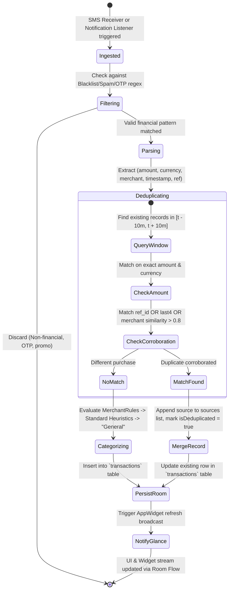

# Phase 1 Data Model: Local Expense Tracker

**Feature**: `001-local-expense-tracker`  
**Date**: 2026-10-22  
**Storage Engine**: AndroidX Room SQLite Database (`expense_tracker.db`) + Jetpack DataStore

---

## 1. Database Schema & Room Entities

### 1.1 `transactions` Entity
Represents an individual financial transaction captured via SMS, Email notification, or manual entry.

```kotlin
@Entity(
    tableName = "transactions",
    indices = [
        Index(value = ["timestamp"]),
        Index(value = ["category_id"]),
        Index(value = ["month_key"]),
        Index(value = ["amount", "timestamp"]),
        Index(value = ["reference_id"], unique = false)
    ],
    foreignKeys = [
        ForeignKey(
            entity = CategoryEntity::class,
            parentColumns = ["id"],
            childColumns = ["category_id"],
            onDelete = ForeignKey.SET_DEFAULT
        )
    ]
)
data class TransactionEntity(
    @PrimaryKey
    @ColumnInfo(name = "id")
    val id: String = UUID.randomUUID().toString(),

    @ColumnInfo(name = "amount")
    val amount: Double, // Always positive; type dictates sign

    @ColumnInfo(name = "currency")
    val currency: String, // ISO-4217, e.g., "USD", "INR", "EUR"

    @ColumnInfo(name = "type")
    val type: TransactionType, // DEBIT or CREDIT

    @ColumnInfo(name = "timestamp")
    val timestamp: Long, // Epoch milliseconds

    @ColumnInfo(name = "month_key")
    val monthKey: String, // "YYYY-MM", e.g. "2026-10" for fast indexing

    @ColumnInfo(name = "merchant_raw")
    val merchantRaw: String, // Raw merchant/payee string extracted from message

    @ColumnInfo(name = "merchant_clean")
    val merchantClean: String, // Normalized merchant display name

    @ColumnInfo(name = "category_id", defaultValue = "general")
    val categoryId: String,

    @ColumnInfo(name = "sources")
    val sources: List<SourceChannel>, // JSON or TypeConverter: ["SMS"], ["EMAIL"], or ["SMS", "EMAIL"]

    @ColumnInfo(name = "is_deduplicated")
    val isDeduplicated: Boolean = false,

    @ColumnInfo(name = "reference_id")
    val referenceId: String? = null, // UTR, transaction sequence number, or bank ref

    @ColumnInfo(name = "account_last4")
    val accountLast4: String? = null, // Last 4 digits of card/account

    @ColumnInfo(name = "raw_snippet")
    val rawSnippet: String? = null, // Truncated original text for user verification

    @ColumnInfo(name = "notes")
    val notes: String? = null,

    @ColumnInfo(name = "created_at")
    val createdAt: Long = System.currentTimeMillis()
)

enum class TransactionType {
    DEBIT,
    CREDIT
}

enum class SourceChannel {
    SMS,
    EMAIL,
    MANUAL
}
```

---

### 1.2 `categories` Entity
Represents an expense category used for budgeting and reporting.

```kotlin
@Entity(
    tableName = "categories",
    indices = [
        Index(value = ["name"], unique = true)
    ]
)
data class CategoryEntity(
    @PrimaryKey
    @ColumnInfo(name = "id")
    val id: String, // e.g., "food_dining", "groceries", "transport"

    @ColumnInfo(name = "name")
    val name: String, // Display title, e.g., "Food & Dining"

    @ColumnInfo(name = "icon_name")
    val iconName: String, // Vector icon key, e.g., "ic_utensils", "ic_shopping_bag"

    @ColumnInfo(name = "color_hex")
    val colorHex: String, // Hex token, e.g., "#10B981"

    @ColumnInfo(name = "monthly_budget_limit")
    val monthlyBudgetLimit: Double? = null, // Optional category ceiling

    @ColumnInfo(name = "is_system_default")
    val isSystemDefault: Boolean = false,

    @ColumnInfo(name = "sort_order")
    val sortOrder: Int = 0
)
```

**Default Pre-Populated System Categories**:
1. `food_dining`: Food & Dining (`#F59E0B` Champagne Gold, icon: `utensils`)
2. `groceries`: Groceries (`#10B981` Forest Emerald, icon: `shopping_cart`)
3. `shopping`: Shopping (`#8B5CF6` Royal Violet, icon: `shopping_bag`)
4. `transport`: Transport & Commute (`#3B82F6` Royal Cobalt, icon: `car`)
5. `utilities`: Bills & Utilities (`#EC4899` Rosewood, icon: `zap`)
6. `entertainment`: Entertainment (`#06B6D4` Teal, icon: `film`)
7. `health`: Health & Wellness (`#14B8A6` Mint, icon: `heart_pulse`)
8. `income`: Salary & Deposits (`#22C55E` Spring Green, icon: `trending_up`)
9. `general`: General / Uncategorized (`#64748B` Slate, icon: `more_horizontal`)

---

### 1.3 `merchant_rules` Entity
Stores user-trained and heuristic pattern rules for auto-categorization.

```kotlin
@Entity(
    tableName = "merchant_rules",
    indices = [
        Index(value = ["pattern"], unique = true),
        Index(value = ["category_id"])
    ],
    foreignKeys = [
        ForeignKey(
            entity = CategoryEntity::class,
            parentColumns = ["id"],
            childColumns = ["category_id"],
            onDelete = ForeignKey.CASCADE
        )
    ]
)
data class MerchantRuleEntity(
    @PrimaryKey
    @ColumnInfo(name = "id")
    val id: String = UUID.randomUUID().toString(),

    @ColumnInfo(name = "pattern")
    val pattern: String, // Keyword or regex, e.g., "STARBUCKS", "UBER", "WALMART"

    @ColumnInfo(name = "category_id")
    val categoryId: String,

    @ColumnInfo(name = "is_regex")
    val isRegex: Boolean = false,

    @ColumnInfo(name = "priority")
    val priority: Int = 100, // Higher priority evaluated first

    @ColumnInfo(name = "created_at")
    val createdAt: Long = System.currentTimeMillis()
)
```

---

### 1.4 `monthly_budgets` Entity
Stores overall monthly budget limits and month configuration.

```kotlin
@Entity(
    tableName = "monthly_budgets",
    indices = [
        Index(value = ["month_key"], unique = true)
    ]
)
data class MonthlyBudgetEntity(
    @PrimaryKey
    @ColumnInfo(name = "month_key")
    val monthKey: String, // "YYYY-MM"

    @ColumnInfo(name = "budget_limit")
    val budgetLimit: Double, // e.g. 2500.00

    @ColumnInfo(name = "alert_threshold_percent")
    val alertThresholdPercent: Int = 85 // Alert when spending exceeds 85% of budget
)
```

---

## 2. In-Memory & UI State Models

### 2.1 `MonthlyDashboardState`
```kotlin
data class MonthlyDashboardState(
    val monthKey: String, // "2026-10"
    val displayMonth: String, // "October 2026"
    val totalDebit: Double = 0.0,
    val totalCredit: Double = 0.0,
    val netBalance: Double = 0.0,
    val budgetLimit: Double = 0.0,
    val budgetProgress: Float = 0f, // 0.0 to 1.0+
    val remainingBudget: Double = 0.0,
    val categoryBreakdowns: List<CategoryBreakdown> = emptyList(),
    val recentTransactions: List<TransactionItem> = emptyList(),
    val isHistoricalScanning: Boolean = false,
    val activeChannels: IngestionChannels = IngestionChannels(sms = true, email = true)
)

data class CategoryBreakdown(
    val categoryId: String,
    val name: String,
    val colorHex: String,
    val iconName: String,
    val totalSpent: Double,
    val percentageOfTotal: Float,
    val transactionCount: Int
)

data class TransactionItem(
    val id: String,
    val amount: Double,
    val formattedAmount: String,
    val currency: String,
    val type: TransactionType,
    val merchant: String,
    val categoryName: String,
    val categoryColor: String,
    val categoryIcon: String,
    val dateFormatted: String,
    val sources: List<SourceChannel>,
    val isDeduplicated: Boolean,
    val accountLast4: String?
)
```

---

## 3. Data Flow & State Machine

### 3.1 Transaction Ingestion State Machine



---

## 4. Jetpack DataStore Preferences

File: `settings.preferences_pb`
- `PREF_KEY_SMS_ENABLED`: Boolean (default: true)
- `PREF_KEY_EMAIL_ENABLED`: Boolean (default: true)
- `PREF_KEY_DEFAULT_CURRENCY`: String (default: device locale ISO code, e.g. "USD")
- `PREF_KEY_MONTHLY_BUDGET_DEFAULT`: Double (default: 2000.0)
- `PREF_KEY_HISTORICAL_SCAN_COMPLETED`: Boolean (default: false)
- `PREF_KEY_DEDUPLICATION_WINDOW_MINUTES`: Int (default: 10)
