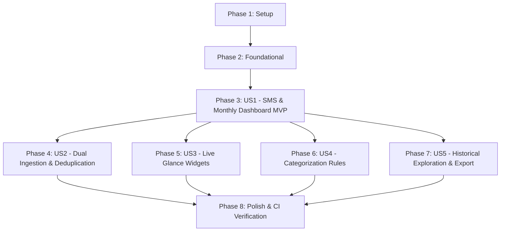

# Tasks: Local Monthly Expense Tracker with SMS/Email Deduplication & Live Widgets

**Input**: Design documents from `specs/001-local-expense-tracker/` (plan.md, spec.md, data-model.md, research.md, contracts/, quickstart.md)  
**Prerequisites**: plan.md, spec.md, data-model.md, contracts/  
**Organization**: Tasks are grouped by phase and user story to enable independent implementation and testing of each story.

---

## Phase 1: Setup (Shared Infrastructure)

**Purpose**: Android project initialization, dependency version catalog, and GitHub Actions CI/CD pipeline

- [X] T001 Create Gradle Version Catalog with Compose, Glance, Room, Hilt, and Kotlin dependencies in android/gradle/libs.versions.toml
- [X] T002 [P] Configure root Gradle build script and settings in android/build.gradle.kts and android/settings.gradle.kts
- [X] T003 [P] Configure app module build script with plugins, Android 15 compileSdk, minSdk 26, and dependencies in android/app/build.gradle.kts
- [X] T004 [P] Setup AndroidManifest.xml with required permissions (SMS, NotificationListener) and Application declaration in android/app/src/main/AndroidManifest.xml
- [X] T005 [P] Implement GitHub Actions automated build, lint, test, and artifact upload workflow in .github/workflows/android-ci.yml

---

## Phase 2: Foundational (Blocking Prerequisites)

**Purpose**: Core design tokens, Room database architecture, and dependency injection setup

**⚠️ CRITICAL**: Must be completed before user story implementation begins

- [X] T006 Implement Dribbble FinTech theme tokens (obsidian canvas, emerald, champagne gold, squircles) in android/app/src/main/kotlin/com/innovatex/expensetracker/presentation/theme/ApexThemeTokens.kt
- [X] T007 [P] Implement Material 3 Expressive theme setup and dynamic dark mode in android/app/src/main/kotlin/com/innovatex/expensetracker/presentation/theme/Theme.kt
- [X] T008 [P] Define core domain models (Transaction, Category, MonthlySummary, MerchantRule) in android/app/src/main/kotlin/com/innovatex/expensetracker/domain/model/Models.kt
- [X] T009 [P] Implement Room entities, indices, and TypeConverters in android/app/src/main/kotlin/com/innovatex/expensetracker/data/local/entity/Entities.kt
- [X] T010 Implement Room Database with pre-populated system categories in android/app/src/main/kotlin/com/innovatex/expensetracker/data/local/ExpenseDatabase.kt
- [X] T011 [P] Implement Jetpack DataStore preferences repository for app settings in android/app/src/main/kotlin/com/innovatex/expensetracker/data/local/PreferencesDataStore.kt
- [X] T012 [P] Configure Hilt dependency injection modules for Database, Repositories, and Dispatchers in android/app/src/main/kotlin/com/innovatex/expensetracker/di/AppModule.kt

**Checkpoint**: Core foundation ready — User Story implementation can begin.

---

## Phase 3: User Story 1 - Core Local SMS Expense Capture & Monthly Dashboard (Priority: P1) 🎯 MVP

**Goal**: Ingest financial SMS messages locally, extract transaction details, classify Credit vs Debit, categorize, and render the real-time monthly dashboard.

**Independent Test**: Simulate an incoming bank debit SMS via `adb emu sms send`; verify that the app captures the transaction, extracts amount/merchant, classifies as Debit, assigns to "Groceries", and updates the monthly dashboard spend total.

### Tests for User Story 1

- [X] T013 [P] [US1] Unit test for SMS regex financial parsing and credit/debit classification in android/app/src/test/kotlin/com/innovatex/expensetracker/ingestion/parser/SmsParserTest.kt
- [X] T014 [P] [US1] Unit test for TransactionRepository CRUD and monthly summary Flow in android/app/src/test/kotlin/com/innovatex/expensetracker/data/repository/TransactionRepositoryTest.kt

### Implementation for User Story 1

- [X] T015 [P] [US1] Implement TransactionDao and CategoryDao with reactive Flow queries in android/app/src/main/kotlin/com/innovatex/expensetracker/data/local/dao/TransactionDao.kt
- [X] T016 [P] [US1] Implement TransactionRepositoryImpl with Room Flow streams in android/app/src/main/kotlin/com/innovatex/expensetracker/data/repository/TransactionRepositoryImpl.kt
- [X] T017 [P] [US1] Implement deterministic SMS parser engine with bank keyword heuristics in android/app/src/main/kotlin/com/innovatex/expensetracker/ingestion/parser/SmsParserEngine.kt
- [X] T018 [US1] Implement ParseTransactionUseCase and GetMonthlyDashboardUseCase in android/app/src/main/kotlin/com/innovatex/expensetracker/domain/usecase/DashboardUseCases.kt
- [X] T019 [US1] Implement SmsBroadcastReceiver and 30-day historical SMS scanner in android/app/src/main/kotlin/com/innovatex/expensetracker/ingestion/sms/SmsIngestionService.kt
- [X] T020 [P] [US1] Implement Dribbble FinTech squircle summary card and skeleton shimmer components in android/app/src/main/kotlin/com/innovatex/expensetracker/presentation/components/ApexCards.kt
- [X] T021 [P] [US1] Implement transaction list row item with category icons and tactile feedback in android/app/src/main/kotlin/com/innovatex/expensetracker/presentation/components/TransactionRow.kt
- [X] T022 [US1] Implement DashboardViewModel with MVI StateFlow in android/app/src/main/kotlin/com/innovatex/expensetracker/presentation/dashboard/DashboardViewModel.kt
- [X] T023 [US1] Implement MonthlyDashboardScreen with physics spring animations and edge-to-edge layout in android/app/src/main/kotlin/com/innovatex/expensetracker/presentation/dashboard/MonthlyDashboardScreen.kt
- [X] T024 [US1] Integrate MainActivity with Compose Navigation and permission request flow in android/app/src/main/kotlin/com/innovatex/expensetracker/MainActivity.kt

**Checkpoint**: User Story 1 is functional as an independent MVP.

---

## Phase 4: User Story 2 - Dual-Channel Ingestion & Deduplication Engine (Priority: P2)

**Goal**: Ingest email alerts via NotificationListenerService and deduplicate identical transactions arriving via SMS and Email within a 10-minute window without double-counting.

**Independent Test**: Trigger an SMS and an Email notification for the same purchase ($18.75 at Starbucks) within 1 minute; verify only one transaction is recorded, tagged as "SMS + Email", and monthly spend increments only once.

### Tests for User Story 2

- [X] T025 [P] [US2] Unit test for DeduplicateTransactionUseCase sliding window correlation in android/app/src/test/kotlin/com/innovatex/expensetracker/domain/usecase/DeduplicationTest.kt
- [X] T026 [P] [US2] Unit test for Email notification alert parser in android/app/src/test/kotlin/com/innovatex/expensetracker/ingestion/parser/EmailParserTest.kt

### Implementation for User Story 2

- [X] T027 [P] [US2] Implement NotificationListenerService for email transaction notifications in android/app/src/main/kotlin/com/innovatex/expensetracker/ingestion/notification/EmailNotificationListenerService.kt
- [X] T028 [P] [US2] Implement email notification parser engine in android/app/src/main/kotlin/com/innovatex/expensetracker/ingestion/parser/EmailParserEngine.kt
- [X] T029 [US2] Implement DeduplicateTransactionUseCase with 10-minute sliding window logic in android/app/src/main/kotlin/com/innovatex/expensetracker/domain/usecase/DeduplicateTransactionUseCase.kt
- [X] T030 [US2] Implement unified IngestionPipeline connecting SMS and Email channels through Deduplication in android/app/src/main/kotlin/com/innovatex/expensetracker/ingestion/IngestionPipeline.kt
- [X] T031 [P] [US2] Add dual-source badges ("SMS + Email") and ingestion toggles in android/app/src/main/kotlin/com/innovatex/expensetracker/presentation/components/SourceBadges.kt

**Checkpoint**: User Story 2 complete — SMS and Email dual-ingestion seamlessly deduplicates without cloud services.

---

## Phase 5: User Story 3 - Live Android Home Screen Widgets (Priority: P3)

**Goal**: Display real-time monthly expense balance and budget progress on Android home screen widgets with sub-3-second updates.

**Independent Test**: Add a 4x2 widget to the home screen showing $850 spent. Add a $50 expense in the app; verify the home screen widget updates to $900 within 3 seconds.

### Tests for User Story 3

- [X] T032 [P] [US3] Unit test for ExpenseWidgetState calculation and formatting in android/app/src/test/kotlin/com/innovatex/expensetracker/widget/WidgetStateTest.kt

### Implementation for User Story 3

- [X] T033 [P] [US3] Implement ExpenseWidgetSyncManager with debounced update broadcast in android/app/src/main/kotlin/com/innovatex/expensetracker/widget/ExpenseWidgetSyncManager.kt
- [X] T034 [US3] Implement Small (2x2) Balance Ring Glance widget in android/app/src/main/kotlin/com/innovatex/expensetracker/widget/SmallExpenseGlanceWidget.kt
- [X] T035 [US3] Implement Medium (4x2) Category Progress Glance widget in android/app/src/main/kotlin/com/innovatex/expensetracker/widget/MediumExpenseGlanceWidget.kt
- [X] T036 [US3] Implement Large (4x4) Full Ledger Glance widget in android/app/src/main/kotlin/com/innovatex/expensetracker/widget/LargeExpenseGlanceWidget.kt
- [X] T037 [US3] Configure AppWidgetProvider metadata XML and Glance receivers in android/app/src/main/res/xml/expense_widget_info.xml

**Checkpoint**: User Story 3 complete — Live Glance widgets reflect real-time financial changes on the home screen.

---

## Phase 6: User Story 4 - Local Categorization Customization & Merchant Rule Learning (Priority: P4)

**Goal**: Enable manual category reassignment, learn local merchant rules, and allow custom category creation.

**Independent Test**: Reassign a transaction from "General" to "Food & Dining" and enable "Always apply for this merchant"; verify future transactions from that merchant auto-categorize as "Food & Dining".

### Tests for User Story 4

- [X] T038 [P] [US4] Unit test for MerchantRule matching and auto-categorization in android/app/src/test/kotlin/com/innovatex/expensetracker/domain/usecase/CategorizationRuleTest.kt

### Implementation for User Story 4

- [X] T039 [P] [US4] Implement MerchantRuleDao in android/app/src/main/kotlin/com/innovatex/expensetracker/data/local/dao/MerchantRuleDao.kt
- [X] T040 [US4] Implement UpdateCategoryRuleUseCase in android/app/src/main/kotlin/com/innovatex/expensetracker/domain/usecase/UpdateCategoryRuleUseCase.kt
- [X] T041 [P] [US4] Implement CategoryPickerBottomSheet and RuleCreationSheet in android/app/src/main/kotlin/com/innovatex/expensetracker/presentation/transaction/CategoryPickerBottomSheet.kt
- [X] T042 [US4] Implement CategoryManagerScreen for custom categories and budget caps in android/app/src/main/kotlin/com/innovatex/expensetracker/presentation/category/CategoryManagerScreen.kt

**Checkpoint**: User Story 4 complete — Local auto-categorization engine learns user preferences.

---

## Phase 7: User Story 5 - Historical Month Exploration & Local Privacy Archive (Priority: P5)

**Goal**: Navigate historical months, view trend velocity, and export local CSV/JSON backup files.

**Independent Test**: Slide month carousel to previous month; verify historical figures remain accurate and export CSV generates locally without network access.

### Tests for User Story 5

- [X] T043 [P] [US5] Unit test for MonthlySummary historical aggregation and CSV serialization in android/app/src/test/kotlin/com/innovatex/expensetracker/domain/usecase/HistoricalArchiveTest.kt

### Implementation for User Story 5

- [X] T044 [US5] Implement GetHistoricalMonthsUseCase in android/app/src/main/kotlin/com/innovatex/expensetracker/domain/usecase/GetHistoricalMonthsUseCase.kt
- [X] T045 [P] [US5] Implement LocalDataExportService for CSV and JSON export via Storage Access Framework in android/app/src/main/kotlin/com/innovatex/expensetracker/data/local/LocalDataExportService.kt
- [X] T046 [US5] Implement MonthCarouselSelector and historical trend breakdown UI in android/app/src/main/kotlin/com/innovatex/expensetracker/presentation/dashboard/MonthCarouselSelector.kt

**Checkpoint**: User Story 5 complete — Retrospective analysis and offline backup capability fully operational.

---

## Phase 8: Polish & Cross-Cutting Concerns

**Purpose**: Memory leak audits, R8 shrinking, in-place upgrade verification, and CI/CD validation

- [X] T047 [P] Configure LeakCanary in debug builds and verify zero memory leaks in android/app/build.gradle.kts
- [X] T048 [P] Configure R8 shrinking, resource optimization, and ProGuard keep rules in android/app/proguard-rules.pro
- [X] T049 [P] Implement Room migration verification unit test using MigrationTestHelper in android/app/src/test/kotlin/com/innovatex/expensetracker/data/local/RoomMigrationTest.kt
- [X] T050 Execute full Gradle build, static analysis, unit tests, and assemble signed APK via ./gradlew check assembleDebug

---

## Dependencies & User Story Completion Order

### Story Independence Analysis
- **US1 (MVP)** is the bedrock; it provides the core local database, parsing engine, and monthly UI.
- **US2, US3, US4, US5** can be implemented and validated in parallel or incrementally once US1 is complete.
- **US3 (Widgets)** depends on the Room database and sync manager established in US1.
- **US2 (Deduplication)** layers on top of the ingestion pipeline without breaking existing SMS parsing.

---

## Parallel Execution Opportunities

### User Story 1 Parallel Stream
- Developer A / Task 1: T015 (DAO) & T016 (Repository)
- Developer B / Task 2: T017 (Regex SMS Parser)
- Developer C / Task 3: T020 (ApexCards) & T021 (TransactionRow)

### User Story 2 Parallel Stream
- Developer A / Task 1: T027 (NotificationListenerService) & T028 (Email Parser)
- Developer B / Task 2: T029 (Deduplication Logic) & T031 (UI Badges)

### User Story 3 Parallel Stream
- Developer A / Task 1: T033 (WidgetSyncManager) & T034 (Small Widget)
- Developer B / Task 2: T035 (Medium Widget) & T036 (Large Widget)

---

## Implementation Strategy

1. **MVP Release (Phase 1 to Phase 3)**:
   - Delivers functional local SMS expense capture, automatic Credit/Debit classification, and the Dribbble-grade Compose monthly dashboard.
2. **Increment 1 (Phase 4)**:
   - Activates dual-channel email notification listening and 10-minute sliding window deduplication.
3. **Increment 2 (Phase 5)**:
   - Activates 2x2, 4x2, and 4x4 AndroidX Glance home screen widgets with sub-3-second live sync.
4. **Increment 3 (Phases 6 & 7)**:
   - Adds rule learning, custom categories, historical month exploration, and offline CSV export.
5. **Release Hardening (Phase 8)**:
   - Validates zero-leak performance via LeakCanary, executes Room migration tests, and runs the GitHub Actions CI pipeline.
